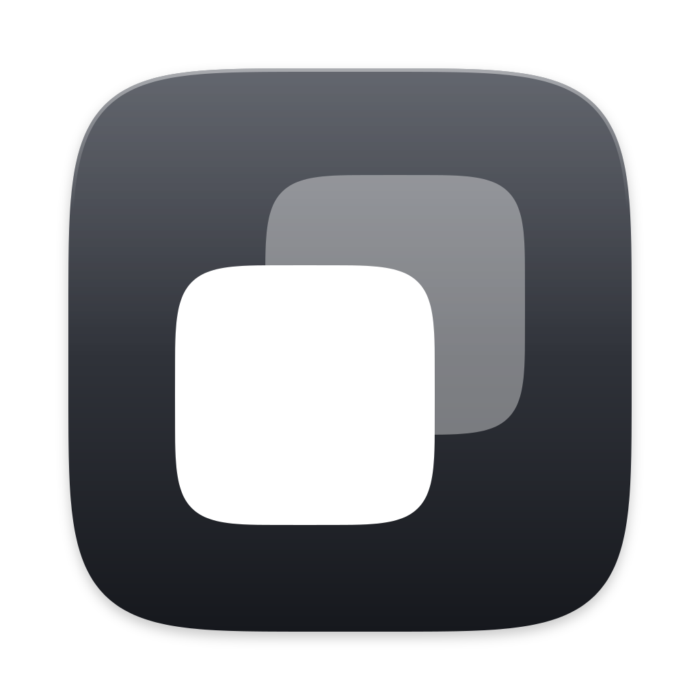

One UI is a shadcn registry built with Next.js, Tailwind CSS, and TypeScript. Every component is animated with Motion, honors `prefers-reduced-motion`, and installs straight into your codebase. You own the code: no package to depend on, restyle anything.

One UI is free. Sponsorship keeps it that way. See the tiers at [ui.huzhihui.com/sponsors](https://ui.huzhihui.com/sponsors).

## Quick start

Install any component with the shadcn CLI:

```bash
npx shadcn@latest add https://ui.huzhihui.com/r/<component-name>.json
```

For example:

```bash
npx shadcn@latest add https://ui.huzhihui.com/r/fluid-orb.json
```

Browse every component, with live previews and props, at [ui.huzhihui.com/components](https://ui.huzhihui.com/components).

To use the short `@one-ui/<component-name>` form, add the registry to your `components.json`:

```json
{
  "registries": {
    "@one-ui": "https://ui.huzhihui.com/r/{name}.json"
  }
}
```

Then:

```bash
npx shadcn@latest mcp init --client claude
# or: --client cursor | vscode
```

Ask: `add @one-ui/fluid-orb`

Or just: `Add the fluid orb from One UI`

Not `add fluid-orb` on its own. That looks in the default shadcn registry.

Full steps: [ui.huzhihui.com/mcp](https://ui.huzhihui.com/mcp).

## Running locally

```bash
git clone https://github.com/zhihui-hu/one-ui.git
cd one-ui
npm install
npm run dev
```

Components live in `components/ui`. After changing a component or `registry.json`, rebuild the registry output with `npm run registry:build`.

<div align="center">
  <br />
  
</div>
